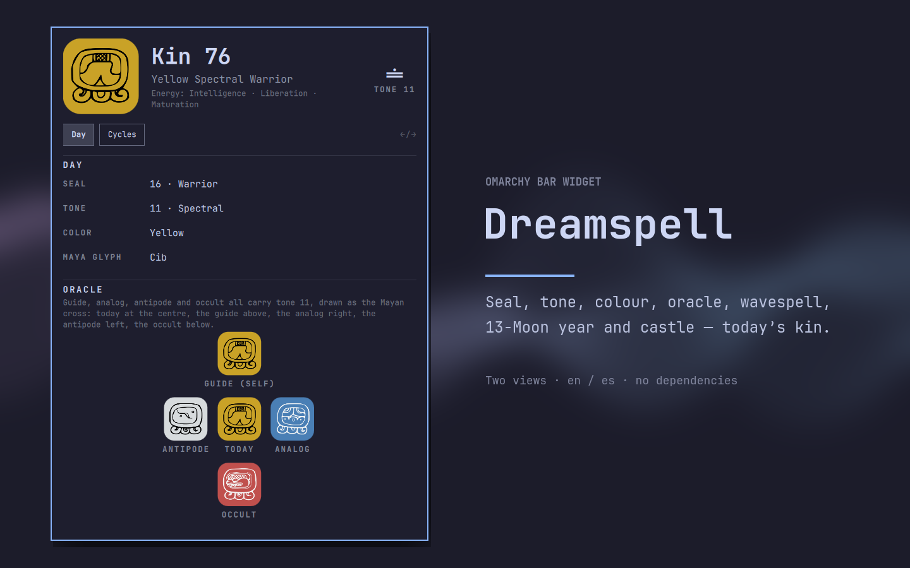

# Dreamspell — Omarchy bar widget

Today's Dreamspell kin in the bar, the full reading on click. Jose Arguelles'
13-Moon calendar: seal, tone, colour, oracle, wavespell, castle and the place
of the day in the 13-Moon year.

Available on the [Omarchy Plugin Marketplace](https://plugins.omarchy.org/plugin.html?id=nathker.dreamspell).

</img>

Built for Omarchy Quattro (`omarchy` 4.x). Pure calendar maths in `Dreamspell.js`,
so the whole model is testable without a running shell.

## Install

```bash
omarchy plugin add https://github.com/na7hk3r/omarchy-dreamspell --enable
```

`add` clones the plugin into your config directory and `--enable` puts the
widget in the bar. If it does not appear, rescan and read the log:

```bash
# Reload the shell so the new widget is picked up.
omarchy-shell shell rescanPlugins
# Check for load errors.
qs log -p "$OMARCHY_PATH/shell" --tail 50
```

The bar should now show the tone and seal of the day, e.g. `11 Dog`.

## Uninstall

```bash
# Out of the bar, files kept.
omarchy plugin disable nathker.dreamspell

# Gone, checkout and all.
omarchy plugin remove nathker.dreamspell
```

Your label format is a plugin setting in `shell.json`, written by the right
click.

## Using it

| Action | Result |
|--------|--------|
| Left click | Opens the reading panel |
| Right click | Cycles the bar label format |
| Left / right arrow | Switches the panel between its two views (also the chips) |
| Hover | Tooltip with the kin, the full traditional name and the seal's keywords |

Label formats, in cycle order:

| `labelFormat` | Bar shows | Notes |
|---------------|-----------|-------|
| `toneSeal` (default) | `11 Dog` | Tone number then Dreamspell seal name |
| `toneNameSeal` | `Spectral Dog` | The same seal, with the tone named instead of counted |
| `kin` | `Kin 50` | The kin number alone |
| `glyph` | `buluk Oc` | The tone in Yucatec Maya, then the day-sign name |
| `icon` | the tone's numeral and the day's glyph | Both marks, no words |

The right click writes the choice to `shell.json`, so it survives a restart.

`glyph` writes the tone in Yucatec Maya rather than with the Dreamspell names:
eleven is `buluk`, not "Spectral". It is the modern orthography, so `kaʼa`,
`joʼo` and `lajkaʼa` carry U+02BC — a modifier letter apostrophe, not a
typewriter one — and `óox` an acute accent; the day-sign names beside them stay
in the classic spellings the glyph files use. The tone's number is still
available in `toneSeal`.

`icon` is the one format with no words, so the tooltip carries the reading. It
draws the tone as a Mayan numeral beside the glyph, which is drawn in the bar's
own foreground colour — white on a dark theme, black on a light one — by picking
between the two polarities that ship in `seals/`. The glyph is drawn at 24px
rather than at the 16px first-party icon canvas: below about 24px the codex
cartouches collapse into the same grey blob, and the day signs stop being
distinguishable from one another. A vertical bar drops the numeral, since its
slot has no width for the pair.

## The panel

- **Hero** — the day's seal drawn as the Mesoamerican glyph on a plaque filled
  with the seal's colour, with the tone beside it as a Maya numeral. Beside
  them, the kin number, the full name (*White Spectral Dog*) and the energy
  line: the seal's essence, the tone's essence and the stage the colour is at,
  so the reading says what the day is *for* and not only what it is called.
- **Day** — seal, tone, colour, Maya glyph name.
- **13-Moon year** — the date inside the 13-Moon year, the moon's full name
  (its tone plus totem, e.g. *Electric Deer*), the day's radial plasma with its
  chakra symbol, the traditional Haab date, the year bearer with its glyph and
  kin, the Gregorian span it covers, and the solar ring written as `NS1.39`.
- **Wavespell** — the 13-day wavespell drawn as thirteen slots, each carrying
  that day's own seal, with the day you are on filled, which day of it this is,
  and the kin that opened it.
- **Castle** — the 52-day castle the wavespell turns in.
- **Oracle** — the four positions drawn as the synchronario's Mayan cross:
  today's seal at the centre, the guide above it, the analog to the right, the
  antipode to the left, the occult below — each with its own glyph and colour
  plaque. All four carry the kin's own tone, as the calendar requires.

Hovering any glyph — the hero, a row's mark, a strip slot, a cross arm, the
tone numeral — says what it is and what it is for: the modern seal with the
classic day sign beside it, then its action, power and essence, e.g.
`Dog (Oc) — Action: Love · Power: Heart · Essence: Loyalty`. The tone numeral
answers the same way with the thirteen tones' own three keywords. The bubble
wraps inside the panel instead of running off the edge.

Colour is carried by the plaque and shape by the glyph, so a reading stays
legible whichever way the theme is set. Each glyph ships in a dark and a light
polarity and the panel picks the one that contrasts with its own plaque: a
single tinted asset was tried first and never applied, which left the artwork in
its file's black on every plaque, saturated ones included.

The panel is anchored to the bar, at the width the native panels use rather than
a full-screen sheet: 480px wide and about 650 tall, so the whole reading sits on
screen at once and nothing needs scrolling. The hero spans the top — the seal on
its colour plaque, the tone numeral, the kin, the full name and the energy line —
and the sections under it are split across two views switched with the chips or
with the left and right arrows:

| View | Sections |
|------|----------|
| **Day** | the day's seal, tone, colour and glyph, then the oracle drawn as the Mayan cross |
| **Cycles** | the thirteen-day wavespell drawn slot by slot, the 13-Moon year, and the castle it turns in |

The hero stays on both views, so the day you opened the panel for never leaves
the screen while you read the cycles around it. A view was chosen over one long
scrolling column because a panel that scrolls has no way to say there is more
below it; the second view announces itself and the arrows are printed beside the
chips. Its type sits on the shell's own scale —
`Style.font.caption` / `body` / `displayLarge` — and its marks and hero plaque on
`Style.space`, exactly like the first-party panels, so it follows the theme's
spacing and font scale without a second, hand-tuned multiplier.

## Languages

The panel and the bar label follow the language picked under **Setup >
Language**, live, without a restart. Catalogues ship in `i18n/` as flat JSON,
one file per language code, wired through the shell's own
`Commons.Translations`:

```qml
Commons.Translations {
  id: strings
  directory: Qt.resolvedUrl("i18n")
}
```

A missing string falls back to its base language, then to `en.json`, then to
the key. English is the base and the fallback; Spanish ships complete.

The translation covers the glyphs, tones, colours, castles and totems, not just
the chrome: `Dog` is `Perro`, `Spectral` is `Espectral`, `White` is `Blanco`.
That is not a find-and-replace, because Spanish puts the adjective after the
noun and inflects it — *White Spectral Dog* is **Perro Espectral Blanco**, and
the year bearer changes gender with its seal: *Luna Galáctica Roja*, *Halcón
Galáctico*. So the word order is a catalogue template (`%1 %2 %3` against
`%3 %2 %1`), and each seal and totem declares its grammatical gender beside its
name. The model stays language-free: it computes in numbers and stable indices
and only then hands the display words through the lookup, so a language change
can never move a kin, a tone or a colour.

Adding a language is one file: copy `i18n/en.json`, translate the values, keep
the keys and the `%1`-style placeholders.

## Calendar notes

The correlation is Dreamspell, not the traditional GMT Tzolkin:

- `kin = norm260( ((year * 365) % 260) + monthDays[m - 1] + day - 28 )`
  with `monthDays = [0, 31, 59, 90, 120, 151, 181, 212, 243, 273, 304, 334]`.
- Anchors: `1987-07-26` → Kin 34 (White Galactic Wizard), the Dreamspell
  anchor. `2026-10-15` → Kin 50 (White Spectral Dog).
- February 29 folds onto February 28 — "0.0 Hunab Ku" — and does not advance
  the kin.
- `seal = ((kin - 1) % 20) + 1`, `tone = ((kin - 1) % 13) + 1`,
  `color = (seal - 1) % 4` → Red, White, Blue, Yellow.
- The 13-Moon year opens on July 26 and closes on July 25, the Day Out of Time.
  Thirteen moons of 28 days is 364, so the year has 365 day-slots.
- Oracle: guide offset by `(tone - 1) % 5` → `[0, -8, +4, -4, +8]`,
  `analog = 19 - seal`, `antipode = seal < 11 ? seal + 10 : seal - 10`,
  `occult = 21 - seal`. Every result wraps into 1..20.
- The solar ring (`anillo solar`) is 52 thirteen-moon years, written
  `NS<ring>.<year>`. The year number is a zero-based offset from the 1987/88
  year, so 2026/27 is `NS1.39`. That is not a guess: 13lunas.net publishes its
  2026/27 synchronary as "Anillo Solar NS1.39 codificado por el Kin 229: Luna
  Galactica Roja (Ano 2026/2027)", and its 2024/25 one as `NS1.37`
  (`2024 - 1987 = 37`). Treating 1987 as year *one* instead of zero shifts every
  ring number by one, which is the mistake this model originally made.

The **Haab** row is the traditional 365-day count: eighteen months (*uinals*)
of twenty days plus the five Wayeb days. It is read off the proleptic Gregorian
date through the Long Count with the standard correlation `584283` — the epoch
`0.0.0.0.0` is `8 Kumkʼu`, which fixes the offset. It is a different count from
the Dreamspell kin, so it is drawn beside the kin rather than derived from it;
`LONG_COUNT_CORRELATION` in `Dreamspell.js` is the single dial if another
correlation is wanted.

The reference implementation at mayankin.com (`dttoday.js`) has a negative-modulo
bug for years divisible by 52 — `2028-01-01`, for instance. This plugin uses a
true modulo and is not a blind port.

## Development

```bash
node --test test/dreamspell.test.js
```

`Dreamspell.js` is deliberately plain — top-level `var` and `function`, no ESM
`export`, no `.pragma` — so the same file runs under `node --test` inside a `vm`
context and inside QML, with no build step and no copy of the model.

`qmllint` is not on `PATH` on Arch, but it ships with Qt:

```bash
/usr/lib/qt6/bin/qmllint -I <import-path-for-qs> BarWidget.qml Panel.qml Dreamspell.js
```

`qs.Commons` and `qs.Ui` resolve from the shell config root at
`/usr/share/omarchy/shell`, so point an import path at a directory containing a
`qs` symlink to it.

## Files

| File | Role |
|------|------|
| `manifest.json` | Plugin manifest, schema version 1 |
| `BarWidget.qml` | Bar label, format cycling, popup host, IPC |
| `Panel.qml` | The reading panel |
| `Dreamspell.js` | Calendar model — kin, oracle, wavespell, castle, 13-Moon, Haab — and the keyword tables behind the hovers |
| `i18n/` | String catalogues, one flat JSON per language (`en.json` is the base) |
| `seals/` | The 20 day-sign glyphs, each in a dark and a light polarity |
| `plasma/` | The seven radial-plasma symbols, one chakra mandala per plasma |
| `fonts/` | `Noto Sans Mayan Numerals`, for the tones, with its OFL licence |
| `test/dreamspell.test.js` | Regression tests over the model (`node --test test/`) |
| `CREDITS.md` | Provenance and licence of every bundled asset |

## License

The code is MIT — see [LICENSE](LICENSE).

The bundled artwork is not: the seal glyphs under `seals/` and the plasma
mandalas under `plasma/` are CC BY-SA 4.0, and the numeral font under `fonts/`
is OFL-1.1. Each carries its own terms, so redistributing this plugin means
honouring all of them. Every file, its author and its licence is listed in
[CREDITS.md](CREDITS.md).
